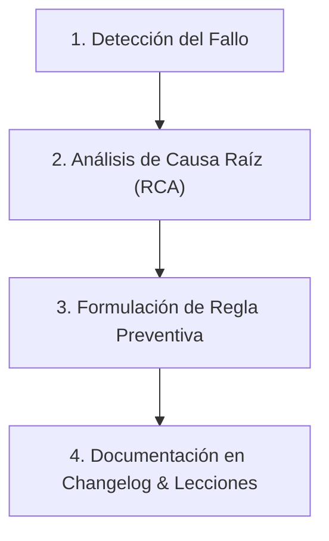

# 🧠 Meta-Learning & Self-Correction Skill

Esta skill dota al agente de una memoria reflexiva y procedural estructurada para **aprender de sus propios errores, registrar correcciones del usuario, diagnosticar fallas y mantener changelogs semánticos reproducibles**.

---

## 🎯 Objetivos de la Skill

1. **Aprender de Errores Operativos y Técnicos**: Identificar causas raíz (*Root Cause Analysis*), patrones de fallo recurrentes y asunciones erróneas.
2. **Auto-Corrección y Prevención**: Convertir cada error corregido en una regla heurística explícita y verificable antes de proceder.
3. **Registro de Bitácora y Changelogs**: Documentar cronológicamente y por semántica de versiones cada cambio metodológico, analítico o técnico en [`CHANGELOG.md`](../../CHANGELOG.md).
4. **Resguardo de Decisiones de Diseño**: Mantener una base viva de lecciones aprendidas en [`docs/lecciones_aprendidas.md`](../../docs/lecciones_aprendidas.md).

---

## 🔄 Protocolo de Aprendizaje Autónomo (4 Pasos)

Cuando ocurra una excepción, una advertencia de herramienta o una corrección directa por parte del usuario:



### 1. Detección del Fallo
- Capturar el error exacto (código de salida, excepción, traceback o señalamiento del usuario).
- **Prohibido adivinar:** No reintentar el mismo comando sin haber modificado la causa.

### 2. Análisis de Causa Raíz (RCA - 5 Whys)
- ¿Por qué falló la llamada o la instrucción?
- ¿Se asumió una ruta inexistente, un codepage incorrecto (e.g. UTF-8 vs CP1252 en Windows) o una dependencia no instalada?
- ¿Se omitió un requerimiento explícito del usuario?

### 3. Formulación de Regla Preventiva
- Redactar una regla en positivo: *"Antes de invocar X herramienta, siempre verificar Y"*.
- Aplicar la corrección directamente en el script, tool o configuración.

### 4. Documentación en Bitácora
- Registrar el incidente en [`docs/lecciones_aprendidas.md`](../../docs/lecciones_aprendidas.md) o [`CHANGELOG.md`](../../CHANGELOG.md).

---

## 📋 Estructura de Documentación

### A. Formato de Entrada en `docs/lecciones_aprendidas.md`
```markdown
### [YYYY-MM-DD] - <Título del Incidente o Aprendizaje>
* **Síntoma / Error:** `Descripción del problema o mensaje de excepción`
* **Causa Raíz:** `Explicación técnica de por qué ocurrió`
* **Solución Aplicada:** `Qué se modificó para resolverlo`
* **Regla Preventiva:** `Directriz que debe seguirse a futuro para evitar su recurrencia`
```

### B. Formato de Entrada en `CHANGELOG.md` (Keep a Changelog + SemVer)
```markdown
## [Unreleased] o [vX.Y.Z] - YYYY-MM-DD
### Added (Añadido)
- Nuevas herramientas, skills o funciones.
### Changed (Cambiado)
- Modificaciones a comportamientos existentes o rutas.
### Fixed (Corregido)
- Corrección de bugs, problemas de codificación o dependencias faltantes.
```

---

## 🛠️ Buenas Prácticas en Proyectos de Investigación

* **Codificación UTF-8 en Windows:** En entornos Windows PowerShell, configurar siempre `[Console]::OutputEncoding = [System.Text.Encoding]::UTF8` y forzar `encoding="utf-8"` al leer y escribir archivos con caracteres especiales o acentos.
* **Aislamiento Multi-Proyecto:** Las herramientas y scripts no deben asumir que las rutas absolutas de un repositorio específico siempre estarán presentes; deben incluir mecanismos de auto-descubrimiento o fallback seguro.
* **Integridad Metodológica:** En análisis cuantitativos o revisiones sistemáticas, los números reportados en textos, tablas y figuras deben coincidir exactamente con los datos fuente sin invención ni redondeos opacos.
