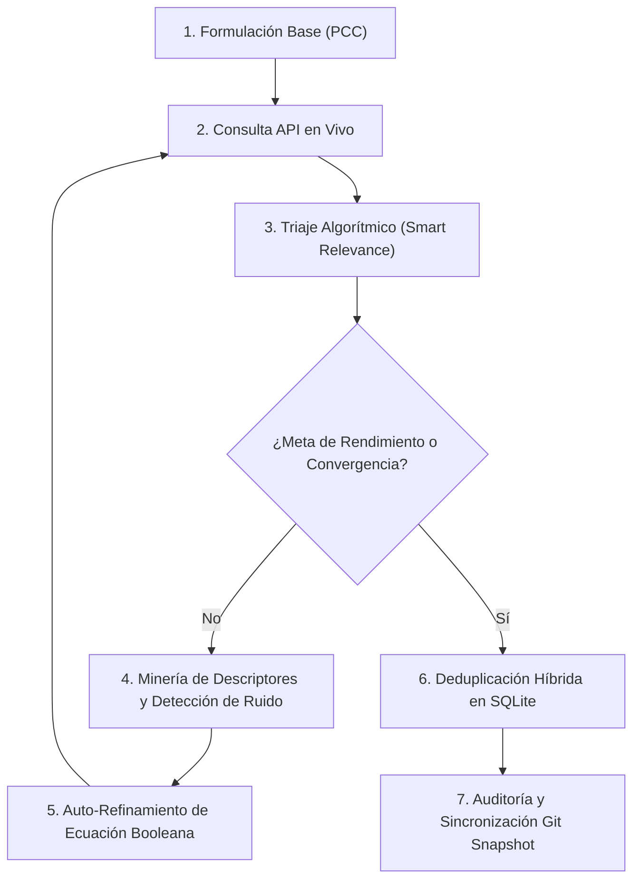

# 🌿 PRISMA-ScR Iterative Research & Evidence Harvesting Skill

Esta skill especializa al agente en la conducción **autónoma, iterativa y autocorrectiva** de búsquedas bibliográficas científicas para Revisiones Exploratorias (*Scoping Reviews*) bajo las directrices del **Joanna Briggs Institute (JBI)** y la extensión **PRISMA-ScR** (Tricco et al., 2018).

---

## 🎯 Capacidades Principales

1. **Consulta Multi-API con Resiliencia:** Conexión concurrente con tolerancia a fallos y reintentos automáticos a:
   * **OpenAlex API:** Catálogo global abierto con indización completa de SciELO, Redalyc y repositorios latinoamericanos.
   * **PubMed / MEDLINE API:** Literatura biomédica y ensayos clínicos con descriptores MeSH.
   * **Crossref API:** Metadatos de editoriales y DOI normalizados bajo *Polite Pool*.
   * **Europe PMC API:** Publicaciones en acceso abierto y literatura internacional.
2. **Ciclo de Aprendizaje Iterativo (Self-Improving Loop):**
   * Evalúa la relación señal/ruido (*Signal-to-Noise Ratio*) tras cada ronda.
   * Extrae descriptores emergentes y n-gramas frecuentes de los artículos de alta relevancia para enriquecer la ecuación positiva.
   * Identifica patrones de ruido somático o biomédico no aplicable (e.g. *in vitro*, *antimicrobial*, *cell culture*, *veterinary*) para autoconstruir filtros booleanos negativos (`NOT`).
3. **Ingestión y Deduplicación Transparente:**
   * Emparejamiento por DOI exacto y similitud difusa de títulos (*RapidFuzz Token Sort Ratio* al 90%).
   * Registro obligatorio en auditoría de búsquedas (`search_logs`) para cumplir los ítems 7 y 8 de PRISMA-ScR.
   * Actualización automática de snapshots (`project_snapshot.json`), matriz de extracción (`tabla_1_extraccion.csv`) y diagrama vectorial (`prisma_flow_diagram.svg`).

---

## 🔄 Flujo Metodológico del Aprendizaje Iterativo



---

## 🛠️ Modos de Ejecución

### Modo A: Mediante el Script de Automatización CLI
El script [`iterative_search.py`](file:///c:/Users/fungicoder/Documents/Fungicoder/Dev/prisma-scr/.agents/skills/prisma-iterative-search/scripts/iterative_search.py) permite ejecutar los ciclos desde terminal:

```powershell
# Búsqueda concurrente en TODAS las APIs (Federated Multi-API)
.venv\Scripts\python.exe .agents\skills\prisma-iterative-search\scripts\iterative_search.py `
  --api federated `
  --query '("medicina tradicional" OR "traditional medicine" OR "fitoterapia") AND ("psicoterapia" OR "salud mental")' `
  --iterations 3 `
  --target 20
```

Parámetros disponibles:
* `--api`: `federated` (recomendada: consulta concurrente en todas las APIs en paralelo), `openalex`, `pubmed`, `crossref`, `europe`.
* `--query`: Ecuación booleana base con los bloques PCC.
* `--iterations`: Número máximo de ciclos de realimentación (default: 3).
* `--target`: Cuota objetivo de estudios pertinentes a recuperar (default: 10).
* `--no-import`: Ejecuta solo la auditoría analítica sin escribir en SQLite.

---

### Modo B: Ejecución Programática por el Agente
Al interactuar en el chat o ejecutar tareas de revisión, el agente debe seguir este protocolo:

1. **Revisar estado previo de la base:**
   ```python
   from core.storage import get_prisma_flow_numbers, get_articles
   stats = get_prisma_flow_numbers()
   existing_articles = get_articles(include_duplicates=True)
   ```
2. **Definir la hipótesis de búsqueda:**  
   Identificar la modalidad de MTCI (e.g. *Fitoterapia en ansiedad*, *Acupuntura en depresión*, *Saberes indígenas en trauma*) y delimitar el contexto geográfico a países latinoamericanos.
3. **Ejecutar iteraciones y analizar convergencia:**  
   Si la precisión inicial es $< 30\%$, activar filtrado de ruido. Si la precisión es $> 70\%$, expandir sinónimos y variantes terminológicas.
4. **Verificar Regla de Consistencia PRISMA (`AGENTS.md`):**  
   Garantizar que la ecuación matemática de flujo se mantenga invariante:
   $$\text{Identificados} - \text{Duplicados} = \text{Cribados}$$
5. **Generar Snapshot y Reporte:**  
   Invocar `export_project_snapshot()` tras cada lote significativo.

---

## ⚖️ Criterios de Neutralidad y Buenas Prácticas Metodológicas
* **No inventar citas ni estudios:** Toda referencia debe provenir de llamadas HTTP verificadas con identificador unívoco (DOI, PMID o URL persistente).
* **Describir con cautela:** Clasificar los hallazgos según el rigor metodológico del diseño (ECA, cuasiexperimento, observacional, cualitativo).
* **Atención al contexto intercultural:** Respetar la legitimidad comunitaria de la medicina tradicional ancestral evitando categorizaciones psiquiátricas reduccionistas descontextualizadas.
