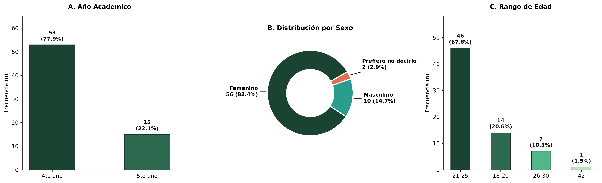
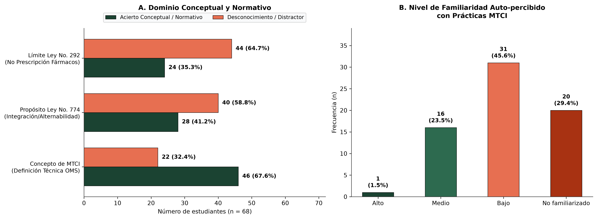
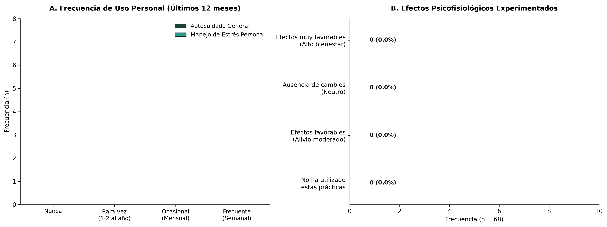
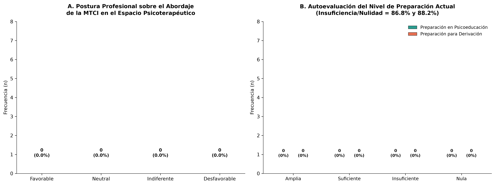
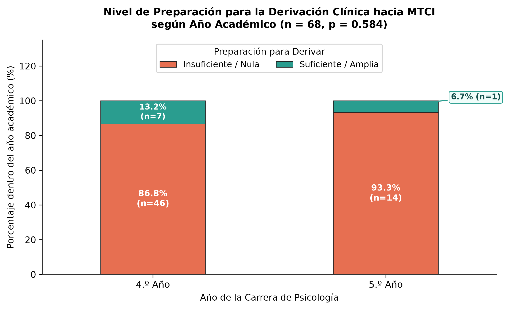

# Capítulo IV: Análisis y Discusión de Resultados (Componente Estudiantil)

**Secciones Integradas:**
- `11.1.1.- Caracterización de estudiantes`
- `11.2.- Caracterización de los conocimientos y la frecuencia de uso de la MTCI de los estudiantes` (Subapartados 11.2.1 a 11.2.8)
- `Cruces Bivariados e Inferenciales y Triangulación Concurrente`

---

## 11.1.- Caracterización de las y los participantes

### 11.1.1.- Caracterización de estudiantes

La muestra estudiantil estuvo conformada por un total de 68 participantes matriculados en los años superiores de la carrera de Licenciatura en Psicología en el Centro Universitario Regional (CUR-Estelí) de la UNAN-Managua, correspondientes a los turnos matutino y por encuentro durante el segundo semestre lectivo del año 2026. A continuación, se detalla la distribución de la muestra en función de las variables sociodemográficas y académicas basales: año de formación, sexo y rango etario.

#### Año de carrera
En cuanto a la trayectoria formativa, el 77.9% de los participantes (53 estudiantes) cursaba el cuarto año de la carrera, mientras que el 22.1% (15 estudiantes) se encontraba en el quinto y último año de formación profesional. La inclusión deliberada de ambos niveles responde a un criterio metodológico central del diseño: los estudiantes de cuarto y quinto año han superado el ciclo básico-teórico e interactúan de forma directa con la práctica clínica y comunitaria a través de sus prácticas preprofesionales, así como en las intervenciones supervisadas en la Clínica Psicosocial y Comunitaria del CUR-Estelí. Este posicionamiento formativo les exige enfrentar demandas reales de consultantes que acuden con hábitos de autocuidado preexistentes.

#### Sexo
Respecto a la distribución por sexo, se constató un marcado predominio del sexo femenino, correspondiente al 82.4% de la muestra (56 participantes), seguido por un 14.7% de hombres (10 participantes) y un 2.9% (2 participantes) que prefirió no declarar su sexo. Esta asimetría concuerda plenamente con las tendencias históricas de matrícula en las facultades de ciencias sociales y humanidades en Nicaragua, donde la disciplina psicológica presenta una elevada feminización en sus cohortes. Resulta significativo notar que este patrón de composición guarda estrecha correspondencia con la unidad de análisis de los facilitadores locales de Estelí (donde el 77.8% correspondió a mujeres terapeutas) y el cuerpo docente (77.8% femenino), evidenciando que el ejercicio del cuidado de la salud mental y la aplicación de terapias tradicionales en el territorio esteliano descansa prominentemente sobre liderazgos femeninos.

#### Edad
Las edades de los participantes se distribuyeron en cuatro grupos: el estrato de 21 a 25 años concentró a la mayoría con un 67.6% (46 estudiantes), seguido del grupo de 18 a 20 años con un 20.6% (14 estudiantes), el rango de 26 a 30 años con un 10.3% (7 estudiantes) y un caso aislado correspondiente a los 42 años (1.5%). La preponderancia de estudiantes en la adultez temprana refleja el flujo generacional regular de la educación superior universitaria, complementado por un segmento que combina estudios en el turno por encuentro con responsabilidades laborales o familiares, aportando madurez empírica a la lectura comunitaria de la salud.

---

## 11.2.- Caracterización de los conocimientos y la frecuencia de uso de la MTCI de los estudiantes

### 11.2.1.- Conocimiento Conceptual

El dominio conceptual fue evaluado a través de dos dimensiones complementarias: la identificación técnica de la definición formal de la MTCI establecida por la Organización Mundial de la Salud (OMS) y la autopercepción sobre el nivel de familiaridad respecto a sus modalidades operativas.

#### Tabla 1
*Distribución de aciertos y errores en la conceptualización de la MTCI (n = 68)*

| Categoría de Respuesta | Frecuencia (n) | Porcentaje (%) | Interpretación Conceptual |
| :--- | :---: | :---: | :--- |
| **Definición técnica OMS (Acierto)** | 46 | 67.6% | Conjunto heterogéneo de saberes y prácticas para la salud |
| **No familiarizado con la definición** | 14 | 20.6% | Reconocimiento explícito de laguna formativa |
| **Reduccionismo espiritual/relajación** | 4 | 5.9% | Distorsión conceptual de la MTCI como mero descanso |
| **Sustitución médica definitiva** | 4 | 5.9% | Creencia errónea de antagonismo con la biomedicina |
| **Total** | **68** | **100.0%** | Muestra total evaluada |

*Nota.* Fuente: Cuestionario diagnóstico aplicado a estudiantes de Psicología, CUR-Estelí (2026).

Como se evidencia en la Tabla 1, el 67.6% de los encuestados (46 estudiantes) seleccionó la definición técnica precisa, reconociendo a la MTCI como una articulación de saberes y prácticas ancestrales y contemporáneas para el bienestar integral. No obstante, un 20.6% reconoció no estar familiarizado con el concepto y un 11.8% incurrió en distorsiones conceptuales, asumiéndola erróneamente como una técnica de relajación pasiva (5.9%) o como una práctica antagónica orientada a sustituir a la biomedicina (5.9%).

Esta comprensión teórica general contrasta sensiblemente con el nivel de familiaridad práctica auto-declarado. El 45.6% de los estudiantes (31 personas) valoró su familiaridad con las prácticas de MTCI en un nivel "Bajo", y un 29.4% (20 personas) manifestó "No estar familiarizado", totalizando un 75.0% de respuestas situadas en los rangos deficitarios de familiaridad. Por el contrario, solo el 23.5% (16 personas) consideró tener un nivel "Medio" y un marginal 1.5% (1 persona) un nivel "Alto".

Este contraste revela que, si bien el estudiantado retiene nociones teóricas generales o intuitivas de lo que implica la MTCI, carece de un contacto estructurado que le permita reconocer la diversidad procedimental de sus técnicas. En términos pedagógicos, los estudiantes conocen la etiqueta conceptual, pero no dominan sus componentes constitutivos, un hallazgo congruente con las observaciones de Cadena et al. (2023) al describir la disociación entre el discurso biomédico formal y el conocimiento empírico de las alternativas terapéuticas.

---

### 11.2.2.- Conocimiento Normativo

El conocimiento de las normas jurídicas es un componente insoslayable para la práctica ética de la psicología en Nicaragua. Para examinar este aspecto, el instrumento indagó sobre los postulados de la Ley No. 774 y las limitaciones impuestas por la Ley No. 292 respecto a la prescripción farmacológica.

#### Tabla 2
*Identificación de los marcos jurídicos nacionales en salud (n = 68)*

| Variable y Norma Evaluada | Acierto Normativo Exacto | Desconocimiento Declarado | Interpretación Distorsionada |
| :--- | :---: | :---: | :---: |
| **Propósito de la Ley No. 774** *(Institucionalización y Alternabilidad)* | 28 (41.2%) | 29 (42.6%) | 11 (16.2%) |
| **Límite Clínico Ley No. 292** *(Inhabilitación de Prescripción Farmacológica)* | 24 (35.3%) | 34 (50.0%) | 10 (14.7%) |

*Nota.* n = 68. En la Ley 774, el 10.3% creyó que la ley busca "sustituir la medicina" y el 5.9% que faculta a "recetar libremente". En la Ley 292, el 10.3% creyó que prohíbe emitir diagnósticos y el 4.4% que prohíbe el autocuidado.

Los resultados reflejan una notable vulnerabilidad en la alfabetización jurídica del estudiantado. Respecto a la Ley No. 774, promulgada en 2012 para garantizar la alternabilidad y la interculturalidad dentro del Modelo de Salud Familiar y Comunitario (MOSAFC), únicamente el 41.2% (28 estudiantes) reconoció su cometido institucional integrador. Un 42.6% admitió ignorar los principios de la ley, mientras que el 16.2% restante asoció la normativa con preceptos falsos, creyendo que promueve el desplazamiento de la medicina formal o que habilita a cualquier terapeuta a recetar sin control sanitario.

Aún más crítico resulta el panorama en torno a la Ley No. 292 (Ley de Medicamentos y Farmacias de 1998). Pese a que esta ley delimita formalmente el ejercicio clínico no prescriptivo del psicólogo en Nicaragua, solo el 35.3% (24 participantes) reconoció con precisión la imposibilidad legal de prescribir psicofármacos como una facultad reservada con exclusividad al cuerpo médico. El 50.0% de los estudiantes (34 participantes) declaró desconocer la limitación legal, un 10.3% confundió la norma con una supuesta prohibición para elaborar diagnósticos psicológicos y un 4.4% creyó que la ley prohíbe sugerir pautas de autocuidado a los consultantes.

Este desconocimiento normativo reviste implicaciones deontológicas severas. El psicólogo que desconoce los alcances de la Ley No. 292 puede deslizarse hacia el intrusismo prescriptivo o, en el extremo opuesto, negarse temerosamente a dialogar sobre hábitos naturales legítimos por confundirlos con faltas legales. Tal como advirtieron los docentes consultados en este estudio, la delimitación jurídica no es un detalle administrativo, sino el perímetro de seguridad que resguarda tanto al paciente como al ejercicio profesional del egresado.

---

### 11.2.3.- Reconocimiento de las Prácticas

Al desglosar las categorías de la MTCI reconocidas por los estudiantes en su entorno local, emergen diferencias significativas según la tipología terapéutica analizada.

#### Tabla 3
*Prácticas de MTCI identificadas y reconocidas por el estudiantado (Respuestas múltiples, n = 68)*

| Bloque Terapéutico | Práctica Específica Reconocida | Frecuencia (n) | Porcentaje (%) |
| :--- | :--- | :---: | :---: |
| **Medicina Natural y Enfoques Generales** | Medicina Ayurveda (Yoga, Meditación, Respiración) | 46 | 67.6% |
| | Fitoterapia y Herbolaria (Plantas medicinales) | 41 | 60.3% |
| | Ninguna de las anteriores | 13 | 19.1% |
| | Medicina Holística e Integrativa | 7 | 10.3% |
| | Nueva Medicina Germánica | 2 | 2.9% |
| **Terapias Complementarias Manuales/Físicas**| Masajes (Terapéutico, relajante, reductivo) | 53 | 77.9% |
| | Hidroterapia, Sauna y Geoterapia (Barroterapia) | 14 | 20.6% |
| | Quiropraxia | 14 | 20.6% |
| | Reflexología y Acupuntura | 13 | 19.1% |
| | Ninguna de las anteriores | 12 | 17.6% |
| **Terapias Energéticas y Psicoemocionales** | Aromaterapia, Terapia Floral y Arte Terapia | 53 | 77.9% |
| | Constelaciones Familiares e Hipnosis | 11 | 16.2% |
| | Curación Energética y Reiki | 6 | 8.8% |
| | Psicoterapia Pránica | 3 | 4.4% |
| | Ninguna de las anteriores | 12 | 17.6% |

*Nota.* n = 68. Los porcentajes corresponden al número de participantes que marcaron cada opción dentro de su bloque.

Los datos indican que las terapias con mayor reconocimiento social y menor nivel de controversia técnica son las más ampliamente identificadas. En el bloque de terapias manuales, los masajes terapéuticos y relajantes alcanzaron el 77.9% de menciones (53 estudiantes), cifra idéntica a la obtenida en el bloque psicoemocional por la tríada conformada por aromaterapia, terapia floral y arteterapia (77.9%). En la medicina natural, el yoga, la meditación y las técnicas respiratorias agruparon un 67.6% de reconocimiento, seguidas de cerca por la fitoterapia tradicional con un 60.3%.

Por el contrario, abordajes más especializados o con menor arraigo institucional en el norte de Nicaragua, como la acupuntura (19.1%), la quiropraxia (20.6%), las constelaciones familiares (16.2%) o las terapias bioenergéticas como el reiki (8.8%) y la psicoterapia pránica (4.4%), presentaron tasas de reconocimiento marcadamente reducidas. 

Este comportamiento corrobora que el imaginario estudiantil en torno a la MTCI se encuentra anclado en aquellas técnicas asociadas a la regulación somática directa, la expresión artística y el alivio de la sobrecarga tensional, coincidiendo con la oferta de servicios terapéuticos reportada por los facilitadores del municipio de Estelí.

---

### 11.2.4.- Experiencias de Bienestar

Al indagar sobre los efectos psicofisiológicos experimentados en primera persona por aquellos estudiantes que han hecho uso de alguna práctica de MTCI, los testimonios cuantitativos muestran una tendencia contundente.

De los 68 participantes, 38 estudiantes (55.9%) reportaron no haber utilizado personalmente estas prácticas durante el periodo de estudio. Sin embargo, dentro del subgrupo de 30 estudiantes que sí han sido usuarios directos de la MTCI, los resultados revelan un beneficio generalizado: 25 estudiantes (36.8% de la muestra total, equivalente al 83.3% de los usuarios activos) describieron efectos favorables reflejados en un alivio moderado de la tensión y bienestar subjetivo; 1 estudiante (1.5%) reportó efectos muy favorables con alto bienestar, y únicamente 4 participantes (5.9%) indicaron una ausencia de cambios o impacto neutro.

Es de resaltar que **ningún estudiante (0.0%) reportó haber experimentado efectos desfavorables o reacciones adversas**. Esta ausencia de eventos indeseados y la alta tasa de beneficio reportado (86.7% de satisfacción entre usuarios) coincide plenamente con los reportes de los facilitadores locales de Estelí, donde el 100% de los terapeutas afirmó observar reducciones significativas en los cuadros de estrés y reactividad somática de sus usuarios. Como señalan Thomson (2023) y Jonge et al. (2017), las técnicas orientadas a la conexión somatopsíquica demuestran una eficacia apreciable en la desactivación del tono simpático en poblaciones sometidas a exigencias académicas continuas.

---

### 11.2.5.- Frecuencia de Uso

Pese a la valoración positiva de los efectos observados, la frecuencia con la que los estudiantes recurren a la MTCI en su cotidianidad es predominantemente baja y esporádica.

En relación con el **autocuidado general**, más de la mitad de los estudiantes (52.9%, 36 participantes) manifestó no recurrir "Nunca" a la MTCI; un 27.9% (19 participantes) indicó usarla "Rara vez" (entre una y dos veces al año), y un 19.1% (13 participantes) reportó un uso "Ocasional" (mensual). Ningún estudiante reportó un uso semanal o intensivo para el autocuidado general.

En el caso del **manejo del estrés personal**, las cifras muestran una ligera elevación en el uso reactivo frente a situaciones de sobrecarga: el 47.1% (32 participantes) refirió no recurrir a estas opciones, pero un 35.3% (24 participantes) las utiliza "Rara vez", un 13.2% (9 participantes) las utiliza de manera "Ocasional" y un 4.4% (3 participantes) las emplea de manera "Frecuente" (semanalmente).

Estos hallazgos permiten constatar que la MTCI opera en el estudiantado como un mecanismo de contención secundario o reactivo, activado principalmente en periodos de alta demanda emocional o evaluación académica, mas no como un hábito sistemático de preservación de la salud. La barrera económica señalada por los terapeutas locales (donde el 77.8% reconoció que los costos de transporte y sesiones limitan el acceso) incide de forma plausible en esta baja frecuencia entre la población universitaria.

---

### 11.2.6.- Valoración de la Praxis

La indagación sobre el impacto que los estudiantes atribuyen a la MTCI en la regulación psicofisiológica de un potencial consultante ofrece una ventana clave hacia sus actitudes terapéuticas futuras.

El 61.8% de los encuestados (42 estudiantes) consideró que el uso de la MTCI ejerce un **"Efecto favorable"** sobre la regulación somática y emocional del consultante, a lo que se añade un 14.7% (10 estudiantes) que lo catalogó como un **"Efecto muy favorable"**. De este modo, tres de cada cuatro estudiantes de psicología (76.5%, 52 participantes) validan la eficacia potencial de estos recursos para coadyuvar en la estabilidad psicofisiológica del individuo. Por su parte, el 23.5% restante (16 estudiantes) adoptó una postura de cautela analítica, señalando que la MTCI tiene un impacto neutro o que no genera cambios determinantes por sí sola.

Esta distribución revela un terreno profesional fértil: la gran mayoría de los futuros profesionales no profesa escepticismo invalidante frente a las técnicas integrativas, sino que reconoce su potencial para modular el sistema nervioso autónomo y facilitar el equilibrio somático, postulado respaldado por la literatura neurofisiológica contemporánea (Van der Kolk, 2015; Thomson, 2023).

---

### 11.2.7.- Pertinencia Clínica

Al evaluar la postura profesional frente al abordaje de la MTCI en el espacio psicoterapéutico —delimitado explícitamente a la psicoeducación, el acompañamiento del autocuidado y la derivación ética a externos, sin confundirlo con la aplicación clínica directa—, las respuestas reflejan una receptividad mayoritaria.

El 39.7% de los estudiantes (27 participantes) expresó una postura abiertamente **"Favorable"** a incorporar este diálogo en la consulta clínica, mientras que el 50.0% (34 participantes) asumió una posición **"Neutral"**, condicionada al análisis individual del motivo de consulta y la supervisión del caso. Por el contrario, solo un 7.4% (5 participantes) se mostró indiferente y apenas un 2.9% (2 participantes) manifestó una postura desfavorable.

Al consolidar estas respuestas, se observa que el **89.7% de la muestra admite la pertinencia del tema en el ejercicio profesional**, reconociendo que los usuarios del sistema de salud traen a la sesión sus vivencias herbolarias, meditativas o corporales. Como señalan Tangkiatkumjai et al. (2020), cuando los terapeutas validan con respeto cultural estas prácticas, se reduce el ocultamiento terapéutico y se fortalece sustancialmente la alianza de trabajo.

---

### 11.2.8.- Preparación Profesional y la Paradoja Formativa

Frente a la apertura conceptual descrita anteriormente, la autoevaluación que los estudiantes realizan sobre su capacidad técnica para intervenir en este terreno expone la contradicción empírica más aguda del estudio: **la brecha formativa institucional**.

#### Tabla 4
*Autopercepción del nivel de preparación en competencias clínicas específicas sobre MTCI (n = 68)*

| Nivel de Preparación Declarado | Preparación para Psicoeducación | Preparación para Derivación Informada |
| :--- | :---: | :---: |
| **Preparación Amplia** | 2 (2.9%) | 1 (1.5%) |
| **Preparación Suficiente** | 7 (10.3%) | 7 (10.3%) |
| **Preparación Insuficiente** | 39 (57.4%) | 36 (52.9%) |
| **Preparación Nula** | 20 (29.4%) | 24 (35.3%) |
| **Total de Brecha Formativa (Insuficiente + Nula)** | **59 (86.8%)** | **60 (88.2%)** |

*Nota.* n = 68. Los porcentajes reflejan el déficit formativo auto-percibido por los estudiantes a punto de egresar de la licenciatura.

Los datos de la Tabla 4 son elocuentes:
1. En relación con la **psicoeducación** (capacidad de explicar al paciente los beneficios, riesgos y contraindicaciones de la MTCI sin salirse de la ética profesional), el **86.8% de los estudiantes** declaró que su preparación es insuficiente (57.4%) o totalmente nula (29.4%). Solo el 13.2% se percibe apto para realizarla.
2. En cuanto a la **derivación clínica e informada** (capacidad de orientar hacia centros, redes o terapeutas acreditados en el municipio de Estelí bajo el amparo de la Ley 774), la brecha alcanza al **88.2% de la muestra** (52.9% insuficiente y 35.3% nula). Únicamente 8 estudiantes en toda la facultad se sienten preparados para referir a un paciente.

Esta desconexión define una paradoja estructural: **los futuros psicólogos reconocen la pertinencia clínica del fenómeno y admiten su eficacia en el 90% de los casos, pero egresan de las aulas con un 88% de sensación de incapacidad técnica y jurídica para actuar ante él**.

---

## 11.3.- Cruces Bivariados e Inferenciales: Análisis de la Brecha Formativa

A fin de comprobar si este déficit en la preparación se subsana a medida que los estudiantes avanzan de nivel o si responde a una ausencia curricular generalizada, se procedió al cruce bivariado entre el año académico de los estudiantes y su nivel de preparación para derivar clínicamente.

#### Tabla 5
*Tabla de contingencia: Año de carrera vs. Nivel de preparación para la derivación clínica hacia MTCI*

| Año de Formación Académica | Preparación Insuficiente / Nula | Preparación Suficiente / Amplia | Total Cohorte |
| :--- | :---: | :---: | :---: |
| **Cuarto Año** | 46 (86.8%) | 7 (13.2%) | 53 (100.0%) |
| **Quinto Año** | 14 (93.3%) | 1 (6.7%) | 15 (100.0%) |
| **Total Muestra** | **60 (88.2%)** | **8 (11.8%)** | **68 (100.0%)** |

*Nota.* $\chi^2 = 0.0577, gl = 1, p = 0.8101$ (Corrección por continuidad de Yates: $\chi^2 = 0.000, p = 1.0000$). Prueba exacta de Fisher (bilateral): $p = 0.6772$.

El análisis inferencial mediante la prueba de Chi-cuadrado de independencia arrojó un estadístico de $\chi^2 = 0.0577$ con 1 grado de libertad y un valor $p = 0.8101$. Al no existir significancia estadística ($p > 0.05$), se concluye que **no existe asociación entre el año académico que se cursa y el nivel de preparación percibido para la derivación clínica**.

La lectura sustantiva de este resultado es de vital trascendencia para la investigación: el hecho de transitar de cuarto a quinto año no incrementa la competencia del estudiante en esta materia. De hecho, en el quinto año —la cohorte que se encuentra en vísperas de graduación y en contacto diario con usuarios en el sistema sanitario— el porcentaje de estudiantes que reporta una preparación insuficiente o nula asciende al 93.3% (14 de 15 estudiantes). Esto demuestra que el vacío no se debe a una inmadurez temporal del estudiante que el tiempo curricular resuelva por sí solo, sino a una omisión sistemática del plan de estudios, ratificando con evidencia estadística la necesidad insoslayable de la propuesta pedagógica que se formula en este informe de tesis.

---

## 11.4.- Triangulación Concurrente con Actores Locales y Docentes

La confrontación de los hallazgos cuantitativos estudiantiles con los testimonios cualitativos recabados entre los facilitadores locales de Estelí ($n = 9$) y el cuerpo docente-psicólogo del CUR-Estelí ($n = 9$) permite articular una lectura holística del fenómeno bajo el prisma del paradigma pragmático.

1. **La eficacia percibida como punto de convergencia:**  
   Mientras los facilitadores locales reportan de forma unánime (100%) que sus técnicas producen una disminución medible de la tensión acumulada y los estudiantes usuarios confirman en un 86.7% haber experimentado alivio subjetivo favorable, el 76.5% de la comunidad estudiantil valida el impacto regulador de estas herramientas. No existe, por tanto, un diferendo sobre la utilidad de la MTCI para mitigar manifestaciones de ansiedad leve o estrés cotidiano.

2. **La tensión burocrática y el ocultamiento como barrera compartida:**  
   Los facilitadores locales advirtieron que un 77.8% de sus usuarios experimenta dudas o reservas iniciales por prejuicios socioculturales, destacando que muchas personas ocultan el uso de terapias complementarias cuando asisten a la consulta psicológica formal. Esta observación empírica empalma directamente con el 88.2% de estudiantes que carece de herramientas para preguntar, explorar y derivar estas prácticas. Al no saber cómo dialogar sobre MTCI, el psicólogo promueve inadvertidamente el silencio del consultante.

3. **El consenso docente hacia la delimitación ética y el trabajo práctico:**  
   Los docentes encuestados manifestaron de forma unánime que la MTCI no debe enseñarse como una doctrina abstracta ni como una habilitación para recetar, sino a través de talleres vivenciales y pautas de derivación claras. El 77.8% del profesorado demandó que la formación incluya la legislación nacional (Leyes 774 y 292), exactamente los dos puntos donde la encuesta estudiantil reveló un desconocimiento de entre el 58% y el 64%. 

En síntesis, la triangulación confirma que el problema no radica en el rechazo mutuo entre la psicología y la medicina tradicional, sino en la **ausencia de un puente curricular formal** que traduzca el mandato legal de interculturalidad de Nicaragua en competencias clínicas y procedimentales concretas para el estudiante de psicología del CUR-Estelí.
